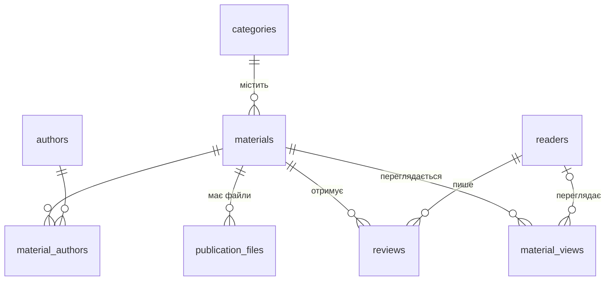

# Лабораторна робота №1 — «Мережева газета факультету»

**Варіант:** 5
**Мова / СУБД:** Haskell (GHC 9.10) · MySQL 8.4

## Завдання

Створити програму на Haskell, використовуючи **classes** та **instances**; як БД використати **MySQL**.

Розробити інформаційну систему «Мережева газета факультету». Таблиці БД містять: назву статті або графічного матеріалу, авторів, текст анотації, де записані файли публікації, інформацію про читачів та їхні відгуки, статистику про окремі матеріали. Передбачити можливість введення та коригування інформації. Кількість таблиць — більше 5.

## Результат

Консольна інформаційна система, яка:

- зберігає дані газети у **8 таблицях** MySQL;
- дозволяє **переглядати, шукати, додавати, редагувати й видаляти** записи будь-якої таблиці;
- показує **картку матеріалу** (автори, файли, відгуки) та **статистику** по ньому;
- реєструє **перегляди** матеріалів у «читацькому режимі»;
- формує **звіти**: топ за переглядами, рейтинг за оцінками, статистика рубрик, активність читачів, продуктивність авторів, загальна статистика.

Уся робота з таблицями реалізована **узагальнено через класи типів**: одна функція CRUD і одне меню обслуговують усі 8 таблиць.

---

## 1. База даних

### Таблиці

| № | Таблиця | Призначення | Відповідність завданню |
|---|---|---|---|
| 1 | `categories` | рубрики газети | — |
| 2 | `materials` | статті та графічні матеріали | назва, вид, текст анотації |
| 3 | `authors` | автори (студенти, викладачі, співробітники) | автор (...) |
| 4 | `material_authors` | зв'язок «матеріал — автор» з роллю | автор (...) |
| 5 | `publication_files` | шляхи / адреси файлів публікації | де записані файли |
| 6 | `readers` | читачі | інформація про читачів |
| 7 | `reviews` | відгуки читачів з оцінкою 1–5 | відгуки |
| 8 | `material_views` | перегляди матеріалів | статистика |

### Схема зв'язків



### Проєктні рішення

- **Нормалізація:** рубрики, автори й читачі зберігаються один раз, інші таблиці посилаються на них зовнішніми ключами.
- **«Багато-до-багатьох»:** у матеріалу може бути кілька авторів (текст, фото), а автор має багато матеріалів — таблиця `material_authors`; `UNIQUE (material_id, author_id)` забороняє дублікати.
- **Цілісність даних (`CHECK`):** оцінка 1–5, розмір файлу ≥ 0, допустимі значення виду, статусу матеріалу та статусу автора.
- **Поведінка при видаленні:**
  - `CASCADE` — з матеріалом видаляються його файли, відгуки, перегляди, зв'язки з авторами;
  - `RESTRICT` — не можна видалити рубрику, в якій є матеріали;
  - `SET NULL` — після видалення читача його перегляди залишаються в статистиці як анонімні.
- **Статистика не зберігається окремо** — вона щоразу обчислюється запитами з `material_views` і `reviews`, тому завжди актуальна.
- Кодування **`utf8mb4`** для коректного зберігання українських текстів.

---

## 2. Структура проєкту

```
lab1/
├── newspaper.cabal     — опис проєкту, модулі, залежності
├── sql/
│   ├── schema.sql      — створення 8 таблиць
│   └── seed.sql        — тестові дані
└── app/
    ├── Main.hs         — консольне меню
    ├── Classes.hs      — власні класи типів
    ├── Models.hs       — типи даних і їхні instances
    ├── Repository.hs   — узагальнений CRUD і пошук
    ├── Stats.hs        — картка матеріалу, звіти, читацький режим
    ├── Console.hs      — введення з перевіркою, вивід таблиць
    └── Db.hs           — підключення до MySQL
```

Бібліотеки: `mysql-simple` (драйвер MySQL), `text`, `time`.

---

## 3. Класи та instances

### Власні класи (`Classes.hs`)

```haskell
-- Перелічення, що зберігається в БД текстовим кодом
class (Eq a, Enum a, Bounded a) => DbEnum a where
  toCode :: a -> Text          -- "article"  (у БД)
  label  :: a -> String        -- "стаття"   (для користувача)

-- Відображення запису
class Display a where
  display :: a -> String
  details :: a -> [String]
  details x = [display x]      -- реалізація за замовчуванням

-- Сутність = таблиця БД
class (QueryResults a, QueryParams a, Display a) => Entity a where
  tableName     :: String
  entityLabel   :: String
  columns       :: [String]    -- стовпці без id
  searchColumns :: [String]
  orderBy       :: String
  orderBy = "id"               -- реалізація за замовчуванням
  entityId      :: a -> Int

-- Сутність, яку можна вводити й коригувати з клавіатури
class Entity a => Editable a where
  input :: Connection -> Maybe a -> IO a   -- Nothing — новий, Just old — коригування
```

Продемонстровано:

- **суперкласи** — `Entity` вимагає `QueryResults`, `QueryParams`, `Display`; `Editable` вимагає `Entity`; `DbEnum` вимагає `Eq`, `Enum`, `Bounded`;
- **методи за замовчуванням** — `details`, `orderBy`;
- **функції з обмеженням класу** — `allValues`, `fromCode`, `enumFromDb` працюють для будь-якого `DbEnum`.

### Типи даних та instances (`Models.hs`)

**Перелічення (типи-суми):** `AuthorStatus`, `MaterialKind`, `MaterialStatus`.
Кожне має instances: `DbEnum`, а також бібліотечні `Param` (запис у SQL) і `Result` (читання з SQL).

```haskell
data MaterialKind = Article | Graphic deriving (Eq, Show, Enum, Bounded)

instance DbEnum MaterialKind where
  toCode Article = "article";  label Article = "стаття"
  toCode Graphic = "graphic";  label Graphic = "графічний матеріал"

instance Param  MaterialKind where render = render . toCode
instance Result MaterialKind where convert f v = enumFromDb (convert f v)
```

**Записи-сутності (типи-добутки):** `Category`, `Author`, `Material`, `MaterialAuthor`, `PublicationFile`, `Reader`, `Review`, `MaterialView` — по одному на таблицю.
Кожен має 5 instances: `QueryResults`, `QueryParams`, `Display`, `Entity`, `Editable`.

```haskell
instance QueryResults Material where          -- рядок БД -> Material
  convertResults fs vs = Material a b c d e f g
    where (a, b, c, d, e, f, g) = convertResults fs vs

instance Entity Material where
  tableName     = "materials"
  columns       = ["title", "kind", "annotation", "category_id", "published_on", "status"]
  searchColumns = ["title", "annotation"]
  ...

instance Editable Material where               -- аплікативний стиль
  input conn old = Material (maybe 0 matId old)
    <$> askText "Назва матеріалу" (matTitle <$> old)
    <*> askChoice label allValues "Вид матеріалу" (matKind <$> old)
    <*> askRef @Category conn "Рубрика" (matCategoryId <$> old)
    ...
```

**Разом:** 4 власні класи, **50 instances** (49 у `Models.hs` + `QueryParams Params` у `Repository.hs`).

### Узагальнений CRUD (`Repository.hs`)

SQL-запити будуються з методів класу `Entity`, тому кожна операція написана **один раз для всіх таблиць**:

```haskell
findAll      :: forall a. Entity a => Connection -> IO [a]
findById     :: forall a. Entity a => Connection -> Int -> IO (Maybe a)
searchText   :: forall a. Entity a => Connection -> Text -> IO [a]
insertEntity :: forall a. Entity a => Connection -> a -> IO Int
updateEntity :: forall a. Entity a => Connection -> a -> IO ()
deleteEntity :: forall a. Entity a => Connection -> Int -> IO Bool
```

Наприклад, `findAll @Material conn` будує `SELECT id, title, kind, ... FROM materials ORDER BY published_on DESC` і перетворює рядки на `[Material]` через instance `QueryResults Material`.
Тип таблиці передається явно через **TypeApplications** (`@Material`).

Так само `entityMenu @a` у `Main.hs` — одне меню (перегляд, пошук, додавання, редагування, видалення) для будь-якого типу з instance `Editable`.

### Інші елементи функціонального стилю

- **Функції вищого порядку:** `askWith` приймає функцію розбору рядка — на ній побудовано всі функції введення; `runMenu` приймає список дій `[(String, IO ())]`.
- **`Maybe`** — для необов'язкових значень (`reader_id` може бути `NULL`) і для режиму введення (новий запис / коригування).
- **Безпечна робота з помилками:** `safely` перехоплює винятки MySQL (наприклад, порушення зовнішнього ключа), програма продовжує роботу.
- **Перевірка введення:** непорожні рядки, e-mail, діапазон оцінки, формат дати, існування `id` у пов'язаній таблиці (`askRef` показує список і не приймає неіснуючий `id`).

---

## 4. Функції програми

```
========== Мережева газета факультету ==========
1. Матеріали (статті та графіка)
2. Рубрики
3. Автори
4. Автори матеріалів (зв'язки)
5. Файли публікацій
6. Читачі
7. Відгуки читачів
8. Перегляди
9. Читати матеріал (картка + реєстрація перегляду)
10. Статистика
0. Вихід
```

Пункти 1–8 відкривають однакове меню таблиці:
*Показати всі · Пошук за текстом · Детально за id · Додати · Редагувати · Видалити.*
При редагуванні поточні значення показуються у `[дужках]`, Enter залишає їх без змін.

**Статистика:**

| Звіт | Що показує |
|---|---|
| Статистика матеріалу | рубрика, автори з ролями, файли, відгуки; переглядів усього, унікальних і анонімних; середня оцінка; перегляди по днях (діаграма) |
| Топ за переглядами | N найпопулярніших матеріалів |
| Рейтинг за оцінками | середня оцінка та кількість відгуків |
| Статистика рубрик | матеріали, перегляди, середня оцінка по рубриках |
| Активність читачів | перегляди та відгуки кожного читача |
| Продуктивність авторів | кількість матеріалів і переглядів їхніх матеріалів |
| Загальна статистика | підсумкові показники газети |

---

## 5. Встановлення та запуск (macOS)

```bash
# 1. Інструменти
brew install mysql@8.4 pkg-config openssl@3 zstd pcre
brew services start mysql@8.4
# Haskell: GHCup (https://www.haskell.org/ghcup/) — GHC + cabal

# 2. База даних і користувач
mysql -u root -e "CREATE DATABASE newspaper CHARACTER SET utf8mb4 COLLATE utf8mb4_unicode_ci;
                  CREATE USER 'news'@'localhost' IDENTIFIED BY 'news123';
                  GRANT ALL PRIVILEGES ON newspaper.* TO 'news'@'localhost';"

# 3. Таблиці та тестові дані
mysql -u news -pnews123 --default-character-set=utf8mb4 newspaper < sql/schema.sql
mysql -u news -pnews123 --default-character-set=utf8mb4 newspaper < sql/seed.sql

# 4. Збірка та запуск
cabal run
```

Параметри підключення задано в `app/Db.hs`.

---

## 6. Тестування

| Перевірка | Очікуваний результат | ✓ |
|---|---|---|
| Перегляд усіх 8 таблиць | дані з БД, українські тексти коректні | ✓ |
| Пошук матеріалу за словом «хакатон» | знайдено матеріал #2 | ✓ |
| Додавання матеріалу з неіснуючою рубрикою | `id` не приймається, повторний запит | ✓ |
| Редагування матеріалу #6 (статус → опубліковано) | інші поля збережені через Enter | ✓ |
| Видалення рубрики з матеріалами | повідомлення про помилку, програма працює далі | ✓ |
| Читання матеріалу #4 | перегляд зареєстровано, лічильник +1 | ✓ |
| Усі 7 звітів статистики | коректні значення | ✓ |

---

## Висновки

У роботі створено інформаційну систему «Мережева газета факультету» на Haskell з базою даних MySQL (8 таблиць).
Основою архітектури є **класи типів**: власні класи `DbEnum`, `Display`, `Entity`, `Editable` та бібліотечні `QueryResults`, `QueryParams`, `Param`, `Result`.
Завдяки цьому операції з БД і меню написано **один раз** і повторно використано для всіх таблиць — для підтримки нової таблиці достатньо оголосити тип даних і його instances.
Реалізовано введення та коригування інформації з перевіркою даних, пошук, а також статистику про окремі матеріали та газету в цілому.