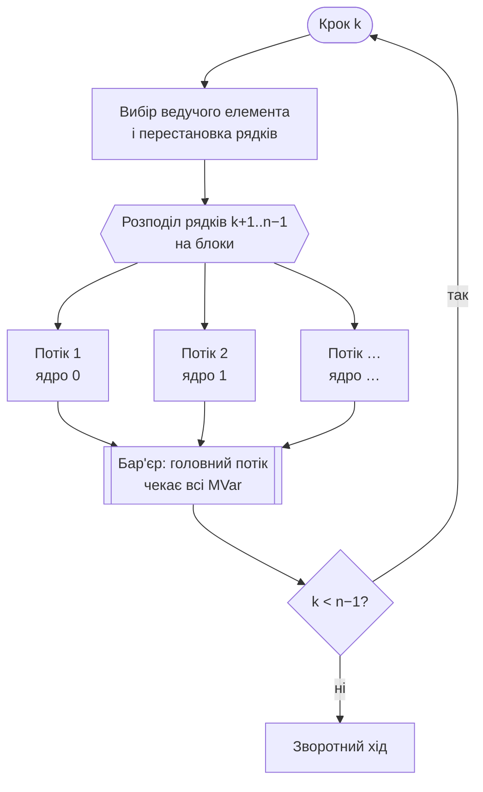
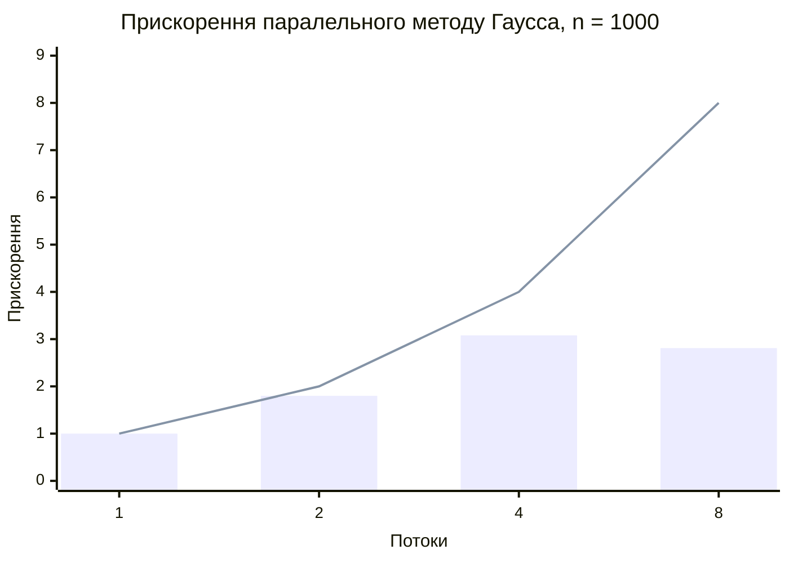

# Лабораторна робота №2 — Паралельний метод Гаусса

**Варіант:** 3
**Мова:** Haskell (GHC 9.10, ключ `-threaded`)

## Завдання

Використовуючи Haskell (GHC з ключем `-threaded`), створити багатопотоковий додаток: розв'язати систему лінійних рівнянь паралельним варіантом методу Гаусса.

## Мета роботи

Опанувати багатопотокове програмування в Haskell (потоки, синхронізація через `MVar`, багатопотоковий runtime GHC), реалізувати паралельний алгоритм розв'язання СЛАР, перевірити його правильність і виміряти прискорення.

## Результат

Консольний додаток, який:

- розв'язує систему **A·x = b** методом Гаусса з вибором ведучого елемента;
- виконує прямий хід **паралельно** на кількох ядрах процесора;
- приймає систему з клавіатури, з файлу або генерує випадкову;
- показує покрокову роботу алгоритму з розподілом рядків між потоками;
- вимірює швидкодію послідовної та паралельної версій (1…N потоків);
- містить **автоматичні тести** (516 перевірок).

---

## 1. Алгоритм

### Метод Гаусса

1. **Прямий хід** — зведення розширеної матриці [A | b] до верхньотрикутного вигляду. На кроці k:
   - вибір ведучого елемента: рядок з найбільшим |aᵢₖ| (i ≥ k) переставляється на місце k — це підвищує точність і усуває ділення на нуль;
   - **виключення**: з кожного рядка i > k віднімається ведучий рядок, помножений на fᵢ = aᵢₖ / aₖₖ.
2. **Зворотний хід** — xᵢ = (bᵢ − Σ aᵢⱼ·xⱼ) / aᵢᵢ, сума по j > i, від останнього рядка до першого.

Складність прямого ходу — O(n³), зворотного — O(n²), тому саме прямий хід визначає час роботи.

### Що розпаралелено

На кроці k рядки k+1…n−1 обробляються **незалежно один від одного**: кожен змінює лише себе, а ведучий рядок k тільки читає. Тому рядки ділимо на неперервні блоки, і кожен блок обробляє окремий потік.



**Послідовними залишаються:**

- **кроки k** — кожен працює з матрицею, отриманою на попередньому кроці;
- **вибір ведучого елемента** — O(n) на крок, незначна частка роботи;
- **зворотний хід** — xᵢ залежить від усіх xⱼ, j > i; його O(n²) становить < 1 % часу при n = 1000.

---

## 2. Реалізація

Увесь код — у `app/Main.hs` (один модуль, розділений на 9 логічних секцій).

### Багатопотоковість

| Засіб | Призначення |
|---|---|
| `-threaded` | багатопотоковий runtime GHC: потоки Haskell виконуються на кількох потоках ОС |
| `-with-rtsopts=-N` | використовувати всі ядра процесора (кількість «capabilities») |
| `forkOn c` | запуск потоку на конкретному ядрі `c` — блоки гарантовано обчислюються на різних ядрах |
| `MVar` | кожен потік по завершенні кладе результат у свою `MVar`; головний потік чекає всі — **бар'єр** між кроками |
| `try` + `mask` | помилка в потоці передається головному потоку, і він ніколи не «зависає» в очікуванні |

Ядро паралельного алгоритму — функція «паралельного циклу»:

```haskell
parallelFor :: Bool -> Int -> Int -> Int -> (Int -> IO ()) -> IO ()
parallelFor force threads lo hi body
  | hi <= lo = return ()
  | threads <= 1 && not force = loop lo hi body
  | otherwise = do
      caps <- getNumCapabilities
      dones <- forM (zip [0 ..] (chunks threads lo hi)) $ \(th, (a, b)) -> do
        done <- newEmptyMVar :: IO (MVar (Either SomeException ()))
        _ <- mask $ \restore ->
               forkOn (capabilityFor caps th) (try (restore (loop a b body)) >>= putMVar done)
        return done
      forM_ dones $ \d -> takeMVar d >>= either throwIO return
```

Прямий хід викликає її на кожному кроці:

```haskell
parallelFor (cfgForceFork cfg) t (k + 1) n (eliminateRow m k pivot)
```

### Чому немає гонок даних

Кожен потік **записує лише у свої рядки**, а ведучий рядок k на цьому кроці лише **читається**. Перестановка рядків виконується до запуску потоків, а наступний крок починається лише після бар'єра. Тому результат не залежить від кількості потоків — це перевіряється тестами (збіг до біта).

### Гранулярність

Створення потоку має накладні витрати, тому функція `threadsFor` дає кожному потоку не менше ~4096 елементів роботи. Наприкінці прямого ходу, коли рядків мало, кількість потоків автоматично зменшується, а останній рядок обробляє головний потік.

### Структури даних

- `LinearSystem` — система у вигляді списків (введення, генерація, перевірка — чисті функції);
- `Matrix` — розширена матриця в `IOUArray Int Double`: змінюваний **неупакований** масив, швидкий доступ без «лінивих» обчислень;
- `SingularMatrix` — власний тип винятку (instance `Exception`) для виродженої матриці.

---

## 3. Структура проєкту

```
lab2/
├── gauss.cabal          — опис проєкту, ключі компіляції (-threaded, -O2)
├── app/
│   └── Main.hs          — увесь код програми
├── data/
│   └── example.txt      — приклад системи 5×5
└── results/
    └── benchmark.md     — збережені результати вимірювань
```

Формат файлу системи: перший рядок — `n`, далі `n` рядків по `n + 1` чисел (`a1 … an b`).

---

## 4. Запуск

```bash
cabal run                        # усі ядра (за замовчуванням)
cabal run gauss -- +RTS -N4      # обмежити 4 ядрами
```

Без cabal:

```bash
ghc -O2 -threaded -rtsopts app/Main.hs -o gauss
./gauss +RTS -N4
```

Меню програми:

```
1. Демонстраційний приклад 4×4 (покроково)
2. Ввести систему з клавіатури
3. Завантажити систему з файлу
4. Порівняти швидкодію: послідовна і паралельна на 1..N потоках
5. Автоматичні тести
0. Вихід
```

Приклад покрокової роботи (пункт 1) — видно розподіл рядків між потоками й ядрами:

```
Крок 1: ведучий елемент a[1][1] = 4.0000 (переставлено рядки 1 і 2)
  потік 1 (ядро 0): рядок 2
  потік 2 (ядро 1): рядок 3
  потік 3 (ядро 2): рядок 4
       4.0000   -6.0000    0.0000    1.0000  |   11.0000
       0.0000    4.0000   -1.0000    2.5000  |   -3.5000
       0.0000    4.0000    2.0000   -0.5000  |   -0.5000
       0.0000    2.5000    5.0000    1.7500  |    9.2500
...
Розв'язок:
   x1   =     1.00000000
   x2   =    -1.00000000
   x3   =     2.00000000
   x4   =     1.00000000

Перевірка: нев'язка ||A·x - b|| = 0.000e0
```

---

## 5. Тестування

Пункт меню 5. Випадкові дані генеруються з фіксованим seed, тому результат відтворюваний. У тестах потоки створюються навіть для малих систем — перевіряється саме паралельний код.

| Група тестів | Перевірок | Що перевіряється | Результат |
|---|---|---|---|
| Відомі приклади | 3 | демо 4×4, файл 5×5, система з a₁₁ = 0 | ✅ |
| Системи з діагональною перевагою, n = 1…80 | 200 | ‖x − x*‖ ≤ 10⁻⁸ відносно відомого розв'язку | ✅ |
| Довільні випадкові матриці | 100 | мала відносна нев'язка (стійкість методу) | ✅ |
| Паралельний = послідовний | 100 | на 1, 2, 3, 4, 7 потоках результат збігається **до біта** | ✅ |
| Перестановка рядків | 50 | вибір ведучого елемента | ✅ |
| Вироджені матриці | 60 | пропорційні рядки, нульовий стовпець — помилку розпізнано | ✅ |
| Граничні випадки | 3 | n = 1; потоків більше, ніж рядків; одинична матриця | ✅ |

```
Пройдено груп тестів: 7 з 7 (усього перевірок: 516)
```

---

## 6. Вимірювання швидкодії

**Умови:** MacBook Air M2 (8 ядер: 4 продуктивні + 4 енергоефективні), випадкова система 1000×1000 з діагональною перевагою, 5 запусків на конфігурацію, перед кожним запуском — примусове прибирання сміття (`performMajorGC`).

| Версія | Потоків | Сер. час, с | Мін. час, с | Прискорення (відн. 1 потоку) | Прискорення (відн. послідовної) | Ефективність |
|---|---|---|---|---|---|---|
| послідовна | 1 | 0.5891 | 0.5816 | — | 1.00 | — |
| паралельна | 1 | 0.5904 | 0.5871 | 1.00 | 1.00 | 1.00 |
| паралельна | 2 | 0.3276 | 0.3188 | 1.80 | 1.80 | 0.90 |
| паралельна | 4 | 0.1918 | 0.1799 | **3.08** | **3.07** | 0.77 |
| паралельна | 8 | 0.2103 | 0.2091 | 2.81 | 2.80 | 0.35 |

Прискорення S = T(1) / T(p), ефективність E = S / p.
Похибка ‖x − x*‖ = 5.3·10⁻¹⁴, нев'язка ‖A·x − b‖ = 5.3·10⁻¹¹; розв'язки всіх конфігурацій збігаються до біта.



*Стовпці — виміряне прискорення, лінія — ідеальне (S = p).*

### Аналіз результатів

1. **Накладні витрати на потоки мізерні.** Паралельна версія на 1 потоці повільніша за послідовну лише на 0.2 % (0.5904 проти 0.5891 с), хоча за 1000 кроків створюється близько тисячі потоків. Потоки Haskell «легкі» — їх створення коштує мікросекунди.

2. **До 4 потоків — добре масштабування:** 1.80× на 2 потоках і 3.08× на 4 (ефективність 90 % і 77 %). За законом Амдала, S(p) = 1 / (f + (1 − f)/p), обидва виміри дають однакову оцінку частки, що не прискорюється: **f ≈ 10 %**. До неї входять послідовні частини (вибір ведучого елемента, перестановка рядків, зворотний хід) і синхронізація на бар'єрі після кожного з 1000 кроків.

3. **На 8 потоках прискорення падає (2.81× < 3.08×)** — через архітектуру M2: 4 ядра продуктивні, а 4 — енергоефективні, приблизно втричі повільніші. Рядки діляться між потоками порівну, а бар'єр змушує кожен крок чекати **найповільніший** потік. Тому на 8 потоках темп задають енергоефективні ядра, і виграш від додаткових ядер з'їдається очікуванням. Додатково 8 потоків конкурують за спільну пропускну здатність пам'яті.

4. **Висновок щодо конфігурації:** для цього процесора оптимально 4 потоки (за кількістю продуктивних ядер). Покращити результат на 8 потоках могло б динамічне розподілення роботи (менші блоки, які вільні потоки забирають з черги), щоб швидкі ядра обробляли більше рядків.

---

## Висновки

Реалізовано багатопотоковий додаток на Haskell для розв'язання СЛАР паралельним методом Гаусса. Паралелізм отримано на рівні рядків прямого ходу: на кожному кроці рядки розподіляються між потоками (`forkOn`), а синхронізація виконується через `MVar` (бар'єр). Гонок даних немає за побудовою, що підтверджено тестами — результат на будь-якій кількості потоків збігається з послідовним до біта.

516 автоматичних перевірок підтверджують правильність на відомих прикладах, випадкових і вироджених матрицях та граничних випадках. На системі 1000×1000 досягнуто прискорення **3.08×** на 4 потоках. Зниження ефективності на 8 потоках пояснюється неоднорідними ядрами M2 і бар'єрною синхронізацією.