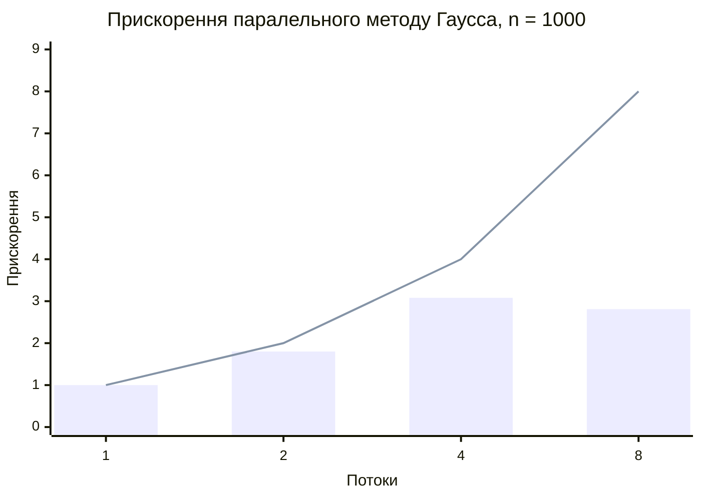

# Вимірювання швидкодії

Система 1000×1000 (випадкова, з діагональною перевагою), 5 запусків на конфігурацію.
Ядер процесора: 8, capabilities (+RTS -N): 8.

| Версія | Потоків | Сер. час, с | Мін. час, с | Приск. відн. 1 потоку | Приск. відн. послідовної | Ефективність | Відх. від послідовної |
| --- | --- | --- | --- | --- | --- | --- | --- |
| послідовна | 1 | 0.5891 | 0.5816 | — | 1.00 | — | 0 |
| паралельна | 1 | 0.5904 | 0.5871 | 1.00 | 1.00 | 1.00 | 0.0e0 |
| паралельна | 2 | 0.3276 | 0.3188 | 1.80 | 1.80 | 0.90 | 0.0e0 |
| паралельна | 4 | 0.1918 | 0.1799 | 3.08 | 3.07 | 0.77 | 0.0e0 |
| паралельна | 8 | 0.2103 | 0.2091 | 2.81 | 2.80 | 0.35 | 0.0e0 |

Стовпці — виміряне прискорення відносно 1 потоку, лінія — ідеальне.

Похибка ||x − x*|| = 5.329e-14, нев'язка ||A·x − b|| = 5.275e-11.
