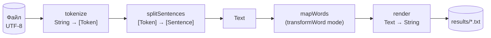

# Лабораторна робота №3 — Обробка тексту підручника з програмування

**Варіант:** 15
**Мова:** Haskell (GHC 9.10)

## Завдання

Створити програму обробки тексту підручника з програмування (який знаходиться у файлі) на Haskell з використанням типів: Символ, Слово, Пропозиція, Розділовий знак та ін. У всіх завданнях з формуванням тексту замінювати табуляції та послідовності пробілів одним пробілом.

**Варіант 15:** перетворити кожне слово у тексті, видаливши з нього наступні (попередні) входження першої (останньої) літери цього слова.

## Мета роботи

Навчитися моделювати предметну область власними алгебраїчними типами даних, використовувати класи типів для узагальненої обробки структур і реалізовувати обробку тексту чистими функціями.

## Результат

Консольна програма, яка:

- читає текст підручника з файлу (UTF-8) і розбирає його на **символи, слова, розділові знаки й речення**;
- замінює табуляції та послідовності пробілів **одним пробілом**;
- виконує перетворення за варіантом в обох режимах:
  - **(А)** видаляє з кожного слова **наступні** входження його **першої** літери;
  - **(Б)** видаляє з кожного слова **попередні** входження його **останньої** літери;
- показує статистику й розбір структури тексту;
- зберігає результати у файли та містить **автоматичні тести** (33 перевірки).

| Слово | (А) перша літера | (Б) остання літера |
|---|---|---|
| level | leve | evel |
| Мама | Маа | Мма |
| лямбда-числення | лямбда-чисення | лмбда-числення |
| programming | programming | proramming |
| Haskell98 | Haskell98 | Haskel98 |
| 2026 | 2026 | 2026 |

**Уточнення умови:**
- літери порівнюються **без урахування регістру** («М» і «м» — одна літера);
- цифри не є літерами, тож слово без літер не змінюється;
- апостроф і дефіс усередині слова належать слову (`пов’язаний`, `лямбда-числення`);
- переходи на новий рядок зберігаються, щоб текст лишався читабельним.

---

## 1. Типи даних

| Тип | Значення |
|---|---|
| `Symbol` | символ тексту |
| `Word` | слово — літери, цифри, `_`; апостроф і дефіс лише всередині |
| `Punctuation` | розділовий знак — будь-який символ, що не є частиною слова чи пробілом |
| `Token` | елемент речення: слово, розділовий знак, пробіл або кінець рядка |
| `Sentence` | речення (пропозиція), що закінчується на `.` `!` `?` `…` |
| `Text` | текст — послідовність речень |
| `Mode` | режим перетворення: `FirstLetter` (А) або `LastLetter` (Б) |

```haskell
newtype Symbol      = Symbol Char
newtype Word        = Word [Symbol]
newtype Punctuation = Punctuation Symbol

data Token
  = TWord Word            -- слово
  | TPunct Punctuation    -- розділовий знак
  | TSpace                -- пробіл (замість будь-якої послідовності пробілів і табуляцій)
  | TNewline              -- кінець рядка

newtype Sentence = Sentence [Token]
newtype Text     = Text [Sentence]
```

## 2. Класи типів

**`Render`** — перетворення будь-якого елемента назад у рядок. Instances для всіх шести типів тексту, від `Symbol` до `Text`: кожен рівень збирається з рендерингу нижчого.

**`HasWords`** — доступ до слів у структурі без зміни решти:

```haskell
class HasWords a where
  wordsOf  :: a -> [Word]                   -- усі слова
  mapWords :: (Word -> Word) -> a -> a      -- застосувати функцію до кожного слова
```

Instances для `Token`, `Sentence` і `Text`. Завдяки цьому перетворення всього тексту — один рядок:

```haskell
transformText :: Mode -> Text -> Text
transformText mode = mapWords (transformWord mode)
```

---

## 3. Обробка тексту



Усі етапи — **чисті функції**; введення-виведення відокремлене від обробки.

- **`tokenize`** розбирає рядок на елементи. Послідовність пробілів і табуляцій одразу стає одним `TSpace` — так виконується загальна вимога завдання.
- **`splitSentences`** ділить елементи на речення. Кінець речення — `.` `!` `?` `…`, якщо за ним (і за можливими `?!`, `...`, `)`, `»`) не йде одразу слово. Тому `3.14`, `2.1` і `[1..10]` не розривають речення.

### Перетворення слова

```haskell
transformWord :: Mode -> Word -> Word
transformWord FirstLetter (Word syms) =
  case break isLetterSym syms of
    (before, l : after) -> Word (before ++ l : filter (not . sameLetter l) after)
    _ -> Word syms
transformWord LastLetter (Word syms) =
  case break isLetterSym (reverse syms) of
    (afterRev, l : beforeRev) ->
      Word (reverse (filter (not . sameLetter l) beforeRev) ++ l : reverse afterRev)
    _ -> Word syms
```

- **(А)** `break` знаходить першу літеру `l`; з частини **після** неї `filter` прибирає всі такі ж літери.
- **(Б)** те саме для перевернутого слова: знаходимо останню літеру й прибираємо її входження з частини **перед** нею.
- `sameLetter` порівнює літери через `toLower`, тобто без урахування регістру.

---

## 4. Приклад роботи

Вхідний файл `data/textbook.txt` — фрагмент підручника «Функціональне програмування» (розділ «2.1 Типи в Haskell»): 4469 символів, 88 рядків, 31 речення, 635 слів, 287 розділових знаків.

**Вхідний текст** (на початку першого рядка — табуляція):

```
	Мова програмування Haskell названа на честь американського
математика Гаскелла Каррі (Haskell Curry), роботи якого в галузі математичної
логіки є базовими для функціонального програмування.
```

**(А) Наступні входження першої літери** — змінено 82 слова з 635:

```
 Мова програмування Haskell назваа на честь америкнського
матеатика Гаскелла Каррі (Haskell Curry), роботи якого в галузі матеатичної
логіки є базовими для функціонального програмування.
```

**(Б) Попередні входження останньої літери** — змінено 124 слова з 635:

```
 Мова програмування Haskel нзвна на честь американськго
мтемтика Гскелла Каррі (Haskel Curry), роботи якго в галузі математичної
логіки є базовми для функцінальнго програмування.
```

Табуляцію на початку рядка замінено одним пробілом; розділові знаки й переходи на новий рядок збережено.

---

## 5. Структура проєкту

```
lab3/
├── lab3.cabal
├── app/
│   └── Main.hs               — увесь код програми
├── data/
│   └── textbook.txt          — текст підручника (вхідний файл)
└── results/                  — створюється програмою
    ├── normalized.txt        — текст після заміни пробілів
    ├── output_first_letter.txt   — перетворення (А)
    └── output_last_letter.txt    — перетворення (Б)
```

`Main.hs` поділено на секції: 1 — типи даних, 2 — класи, 3 — розбір тексту, 4 — перетворення, 5 — статистика, 6 — введення-виведення, 7 — режими роботи, 8 — тести, 9 — меню.

## 6. Запуск

```bash
cabal run                         # файл data/textbook.txt
cabal run lab3 -- інший_файл.txt  # інший файл
```

```
1. Показати текст після заміни табуляцій і пробілів
2. Перетворення (А): видалити наступні входження першої літери слова
3. Перетворення (Б): видалити попередні входження останньої літери слова
4. Перетворити слова, введені з клавіатури
5. Структура тексту (речення, слова, розділові знаки)
6. Автоматичні тести
7. Завантажити інший файл
0. Вихід
```

---

## 7. Тестування

Пункт меню 6 — 33 перевірки:

| Група | Перевірок | Що перевіряється |
|---|---|---|
| Окремі слова | 20 | 10 слів × 2 режими: регістр, апостроф, дефіс, цифри, однолітерні слова |
| Розбір тексту | 6 | заміна пробілів і табуляцій; межі речень (`3.14`, `2.1`, `...`, `?!`, `.)`); виділення слів у коді `x+1`, `'a'` |
| Властивості на всьому файлі | 7 | див. нижче |

Властивості, що перевіряються на всьому тексті підручника:

- розбір і зворотне відображення дають рівно нормалізований текст;
- у результаті немає табуляцій і подвійних пробілів;
- після (А) перша літера трапляється в кожному слові рівно 1 раз; після (Б) — остання;
- повторне перетворення нічого не змінює;
- розділові знаки, пробіли й переходи на новий рядок не змінюються;
- кількість слів і речень не змінюється.

```
Пройдено: 33 з 33
```

---

## Висновки

Розроблено програму обробки тексту підручника з програмування. Текст моделюється ієрархією власних типів (`Symbol` → `Word` / `Punctuation` → `Token` → `Sentence` → `Text`), а класи `Render` і `HasWords` дають узагальнені операції над усіма рівнями. Обробка побудована як ланцюжок чистих функцій: розбір, заміна пробілів, перетворення слів і зворотне відображення. Перетворення за варіантом 15 реалізовано в обох режимах; правильність підтверджують 33 автоматичні перевірки, зокрема властивості на всьому тексті підручника.